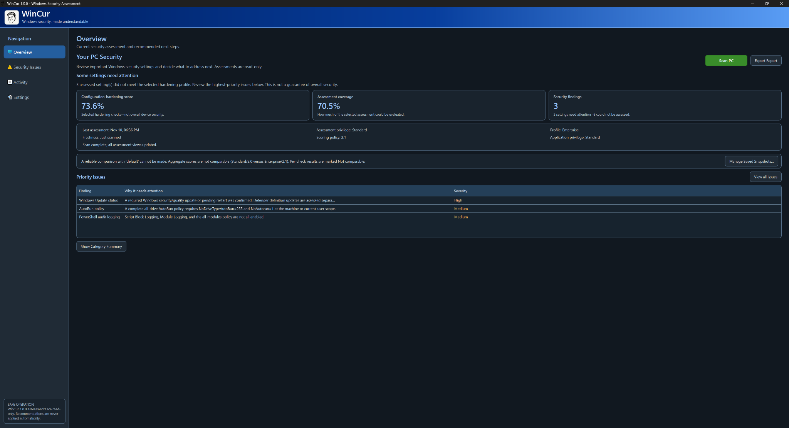
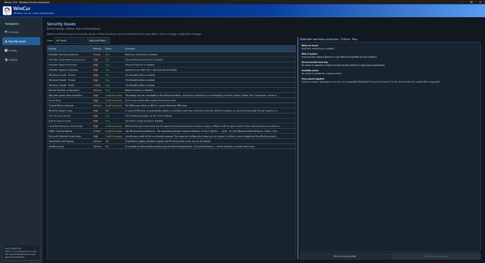
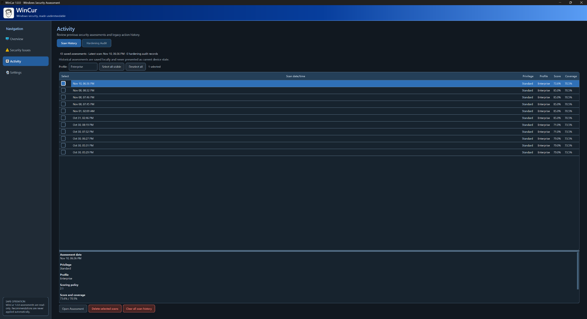

# WinCur

WinCur is a Windows 11 security assessment application that makes important
configuration checks easier to understand. It scans selected Windows security
settings, explains each result in plain language, and highlights the areas that
need attention.

> **WinCur 1.0.0 is assessment-only.** It does not include Administrator Scan,
> automated remediation, or automated rollback, and it does not request UAC
> elevation.

**[Download WinCur 1.0.0 for Windows 11 x64](https://github.com/jchambers2000/WinCur/releases/tag/v1.0.0)**

<p align='center'>
  
</p>

<p align='center'><em>Overview after a completed assessment. The score covers selected configuration checks and is not a guarantee of overall security.</em></p>

The release is a portable ZIP: extract it and launch `WinCur.exe`. Python does
not need to be installed.

## What WinCur provides

- **Read-only security assessments** covering Microsoft Defender, Windows
  Firewall, BitLocker, Secure Boot, TPM, Windows Update, UAC, local accounts,
  SMBv1, Remote Desktop, SmartScreen, PowerShell logging, and AutoRun policy.
- **Standard, Advanced, and Enterprise profiles** for evaluating the same
  device against different configuration expectations.
- **Explainable scoring** with a configuration-hardening score, assessment
  coverage, severity, and a clear distinction between failed, unknown,
  informational, and not-applicable checks.
- **Detailed findings and recommendations** that explain what WinCur observed,
  why it matters, and what to review next.
- **Saved snapshots and comparisons** for comparing a current or historical
  assessment with a reference selected by the user.
- **Local activity and reports** including assessment history and HTML report
  export.
- **Light, Dark, and System themes** in a native PySide6/Qt desktop interface.

WinCur's score measures selected configuration-hardening checks. It is not an
overall measure or guarantee of device security and does not replace endpoint
protection, patching, backups, monitoring, or professional security advice.

## Download and run

1. Open the [WinCur 1.0.0 release](https://github.com/jchambers2000/WinCur/releases/tag/v1.0.0).
2. Download `WinCur-1.0.0-windows-x64.zip` and its published checksum file.
3. Verify the ZIP checksum, then extract the complete archive. Do not run the
   application from inside the ZIP.
4. Keep `WinCur.exe`, the `_internal` folder, and the included license and
   notice files together.
5. Launch `WinCur.exe` and select **Scan PC**.

WinCur 1.0.0 is unsigned. Windows SmartScreen or antivirus software may warn
about a newly downloaded application. Verify the release checksum and
repository provenance before continuing. Do not disable Windows security
protections to run WinCur.

## Understanding an assessment

- **Configuration-hardening score** shows how the assessed checks compare with
  the selected profile.
- **Assessment coverage** shows how much of that profile WinCur could evaluate.
- **Unknown** means the available evidence was insufficient; it is never
  treated as a pass.
- **Informational** and **Not Applicable** results are kept distinct from scored
  failures.

WinCur runs in the current user's security context. Some providers, including
Secure Boot, TPM, BitLocker, local administrator membership, SMBv1, and
SmartScreen, may be unavailable or incomplete because of Windows edition,
permissions, device policy, installed security software, or provider behavior.
The application reports those limitations rather than silently reusing or
inventing results.

## Profiles

| Profile | Purpose |
|---|---|
| Standard | A practical baseline for a personal Windows 11 device |
| Advanced | Broader hardening expectations for users who want a stricter review |
| Enterprise | Organization-oriented expectations where applicable policy context is available |

Profile results should be compared only when their profile and scoring-policy
version are compatible. WinCur records that metadata with saved assessments.

## Snapshots, history, and reports

Saved snapshots are reference assessments chosen by the user. WinCur can
compare later assessments with a snapshot and distinguish confirmed status
changes from cases where different permissions or evidence require review. A
comparison does not claim when a Windows setting changed.

Assessment history, saved snapshots, preferences, legacy read-only hardening
history, and logs are stored below `%LOCALAPPDATA%\WinCur`. Removing the
portable application folder does not remove this local data.

HTML reports can contain the device name, Windows version, local account names
or SIDs, security-product names, update identifiers, timestamps, and
configuration evidence. Review a report before sharing it.

WinCur has no telemetry client and does not upload assessment data. The Windows
Update check uses the Windows Update Agent, which may contact the update service
configured on the device.

## Screenshots

### Security Issues

Review every assessed check with its severity, status, summary, explanation, and
recommended next step. Evidence that WinCur cannot evaluate is reported as
unknown rather than treated as passing.



### Activity

Browse locally stored assessments with their profile, score, coverage, and
scoring-policy metadata. Historical results remain clearly separate from the
current device state.



## Development

WinCur is built with Python, PySide6/Qt, documented Windows interfaces, and a
mocked `unittest` regression suite. From the repository root on Windows 11:

```powershell
py -m venv .venv
.\.venv\Scripts\python.exe -m pip install --upgrade pip
.\.venv\Scripts\python.exe -m pip install -r requirements.txt
.\.venv\Scripts\python.exe main.py
```

Run the non-elevated test suite with:

```powershell
.\.venv\Scripts\python.exe -m unittest discover -s tests
```

The public v1.0.0 executable excludes the legacy Python mutation and elevation
modules and rejects their former command-line modes. Native privileged-helper
work remains source-only security research and is not integrated into the
release application. See [SECURITY.md](SECURITY.md) for the release boundary
and current limitations.

## Project structure

| Area | Location |
|---|---|
| Application entry point | `main.py` |
| Desktop interface and themes | `wincur/ui.py`, `wincur/theme.py`, `wincur/branding.py` |
| Read-only assessment checks | `wincur/checks.py` |
| Scoring policy | `wincur/scoring.py`, `wincur/scoring_config.json` |
| Snapshots and comparisons | `wincur/baselines.py`, `wincur/baseline_comparison.py`, `wincur/drift.py` |
| Persistence and reports | `wincur/storage.py`, `wincur/reporting.py` |
| Packaging and verification | `WinCur.spec`, `tools/`, [PACKAGING.md](PACKAGING.md) |
| Native helper research | `native/privileged-helper/`, `docs/architecture/` |

- Application version: **1.0.0**
- Scoring policy: **2.1**
- Supported release platform: **Windows 11 x64**

## License and notices

WinCur is free and open-source software licensed under the
**GNU General Public License, version 3 only** (`GPL-3.0-only`). See
[LICENSE](LICENSE), [NOTICE.md](NOTICE.md), and
[THIRD_PARTY_NOTICES.md](THIRD_PARTY_NOTICES.md).

The release page includes the corresponding Qt and PySide6 source archives for
the redistributed Qt for Python components.
