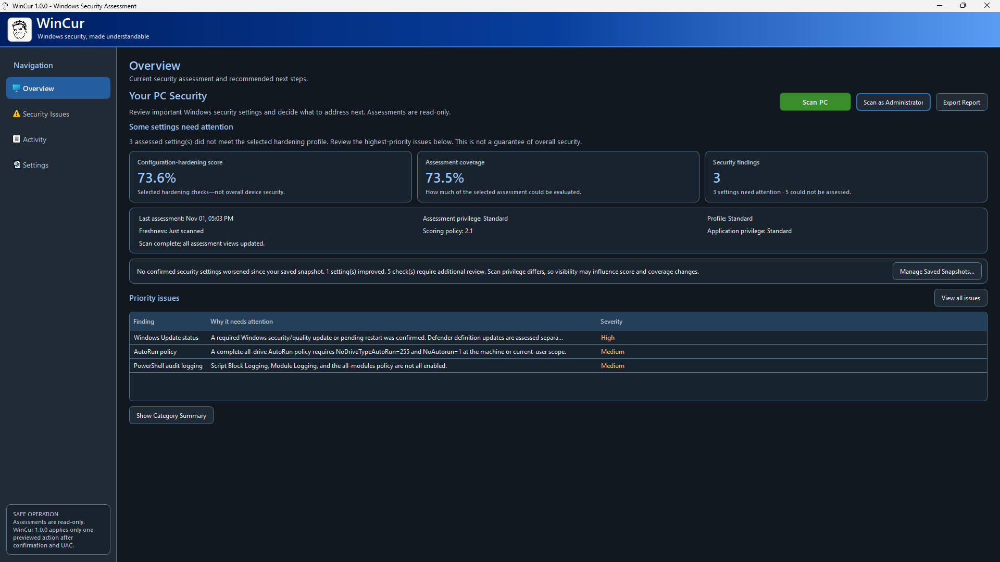
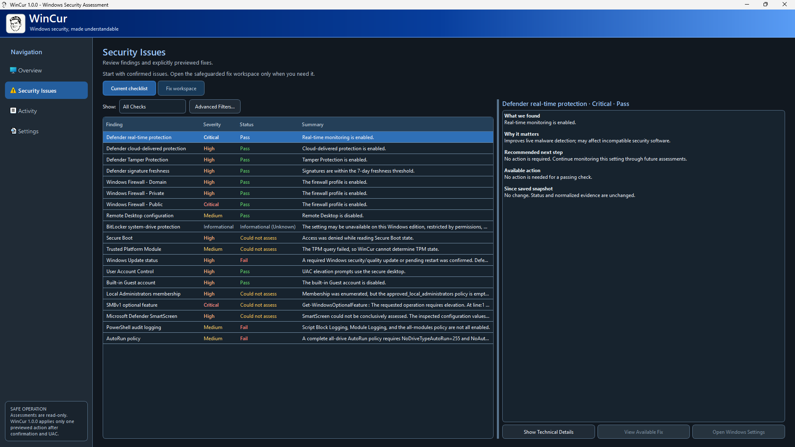
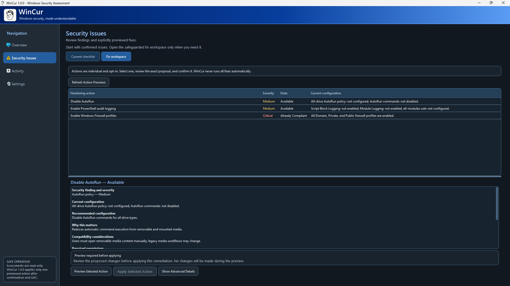
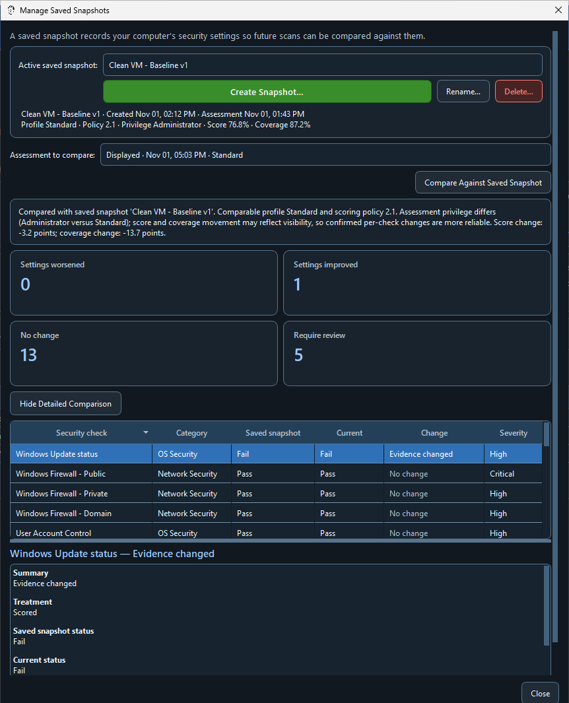
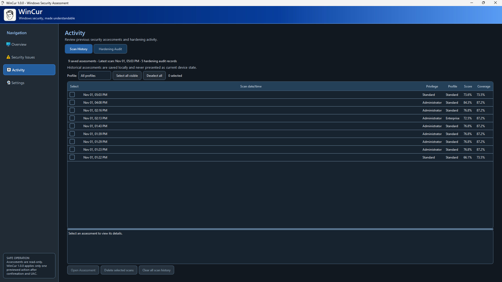

# WinCur

WinCur is a native Windows 11 security assessment and hardening research
application built with Python and PySide6. It evaluates selected endpoint
security configurations, explains each result, and turns technical evidence
into an understandable hardening score, assessment coverage, and prioritized
next steps.

This repository is published as a source-code portfolio project. WinCur is
still under security review and is **not currently recommended for public
binary distribution or production endpoint management**.

<p align="center">
  
</p>

<p align="center"><em>The Overview dashboard summarizes assessed configuration strength, assessment coverage, and confirmed findings without presenting the score as a guarantee of security.</em></p>

## Project status

- Application version: **1.0.0 development candidate**
- Scoring policy: **2.1**
- Platform: Windows 11
- Interface: native PySide6/Qt desktop UI
- Publication scope: source code, tests, documentation, and development tools
- Executables, virtual environments, build outputs, and user data are excluded

The assessment engine is read-only. WinCur also contains three opt-in hardening
workflows—AutoRun policy, PowerShell audit logging, and Windows Firewall
profiles—which can modify Windows after preview, confirmation, and UAC. Known
limitations in the elevated-helper and rollback trust boundaries are documented
in [SECURITY.md](SECURITY.md); do not use those workflows on production systems.

## Capabilities

- **Windows security assessments:** read-only checks for Microsoft Defender,
  Windows Firewall, BitLocker, Secure Boot, TPM, Windows Update, UAC, local
  accounts, SMBv1, Remote Desktop, SmartScreen, PowerShell logging, and AutoRun
  policy.
- **Explainable results:** a configuration-hardening score, assessment coverage,
  severity, plain-language findings, evidence, and recommended next steps.
- **Assessment profiles:** Standard, Advanced, and Enterprise expectations with
  explicit informational and Not Applicable treatment.
- **Privilege-aware scans:** separate Standard and Administrator assessment modes
  so additional visibility is not silently confused with a configuration change.
- **Controlled hardening:** individually selected actions with a read-only
  preview, explicit confirmation, UAC, precondition revalidation, verification,
  audit records, and guarded rollback.
- **Saved snapshots:** user-selected reference assessments for baseline
  comparison and observed configuration-difference analysis.
- **Local history and reporting:** persistent assessment history, hardening audit
  records, and HTML report export with escaped and sanitized evidence.
- **Native desktop experience:** Light, Dark, and Windows-system appearance modes
  in a PySide6/Qt interface.
- **Release engineering:** a portable PyInstaller development workflow with
  unique build IDs, manifest hashes, packaging probes, and distribution checks.

The score measures selected configuration-hardening settings. It is not a
guarantee that a computer is secure and does not replace endpoint protection,
patch management, backups, monitoring, or organizational security policy.

## Technology

- Python 3.11 or newer
- PySide6 / Qt 6
- Windows PowerShell and supported Windows cmdlets
- Documented Windows registry settings and Windows APIs
- `unittest` with mocked Windows providers
- PyInstaller for internal one-directory build evaluation

## Architecture

| Area | Key modules | Responsibility |
|---|---|---|
| Application entry | `main.py` | GUI startup and narrowly scoped helper dispatch |
| Desktop UI | `wincur/ui.py`, `wincur/theme.py`, `wincur/branding.py` | Navigation, views, themes, dialogs, and worker coordination |
| Assessment checks | `wincur/checks.py` | Read-only Windows evidence collection and result classification |
| Scoring | `wincur/scoring.py`, `wincur/scoring_config.json` | Profile-aware scoring and coverage policy |
| Models | `wincur/models.py` | Findings, assessments, previews, and action records |
| Snapshots and comparison | `wincur/baselines.py`, `wincur/baseline_comparison.py`, `wincur/drift.py` | Local reference snapshots and observed differences |
| Hardening | `wincur/hardening.py`, `wincur/helper.py`, `wincur/privileges.py` | Preview, UAC helper, verification, audit, and rollback logic |
| Persistence and reports | `wincur/storage.py`, `wincur/reporting.py`, `wincur/action_history.py` | Local durable storage and HTML export |
| Packaging | `WinCur.spec`, `tools/` | Internal Windows build, verification, and promotion tools |

The ordinary test suite contains 261 test methods. An additional 10 Windows
registry integration tests are deliberately excluded from normal discovery and
must only be run in a disposable VM.

## Development setup

Use a Windows 11 development machine or disposable VM. From the repository
root:

```powershell
py -m venv .venv
.\.venv\Scripts\python.exe -m pip install --upgrade pip
.\.venv\Scripts\python.exe -m pip install -r requirements.txt
.\.venv\Scripts\python.exe main.py
```

Launching the application does not automatically scan or change Windows.
Choose **Scan PC** to run the read-only assessment.

## Tests

Run the mocked regression suite without elevation:

```powershell
.\.venv\Scripts\python.exe -m unittest discover -s tests
```

The separate registry integration harness writes only beneath a uniquely owned
`HKEY_CURRENT_USER\Software\WinCur\IntegrationTests` namespace. Its source and
safety gates are in `tests/integration/registry_rollback_windows.py`. Use it
only in a disposable VM after reviewing the file.

## Safety and data handling

- Assessments do not intentionally modify Windows configuration.
- Hardening actions are separate, explicit, and administrator-authorized.
- WinCur does not collect BitLocker recovery keys, passwords, browsing history,
  or file contents.
- Assessment history, snapshot data, preferences, hardening history, and logs
  are stored locally below `%LOCALAPPDATA%\WinCur`.
- Stored evidence can include the computer name, Windows version, local account
  names and SIDs, security-product names, update identifiers, timestamps, and
  configuration values.
- WinCur has no telemetry client. The Windows Update assessment uses the
  Windows Update Agent, which may contact the update service configured on the
  device.

See [SECURITY.md](SECURITY.md) before evaluating elevated helpers or hardening
features.

## Screenshots

### Security Issues

The checklist separates confirmed results from informational, unavailable, and
unassessed checks. Selecting a row opens its explanation and recommended next
step without crowding the table with raw evidence.



### Fix Workspace

Supported hardening actions are selected individually. WinCur displays the
current and recommended configuration and requires a successful preview before
Apply becomes available; it does not run every fix automatically.



### Saved snapshot comparison

A saved assessment can be used as a reference for later comparisons. Results
distinguish observed improvements, regressions, unchanged checks, and cases
that require review because evidence or assessment visibility differs.



### Activity history

Assessment and hardening activity remain local. Scan history records timestamp,
privilege, profile, score, and coverage while clearly treating saved assessments
as historical rather than current device state.



## Packaging

[PACKAGING.md](PACKAGING.md) documents the internal PyInstaller evaluation
workflow. Build outputs are intentionally excluded from this source-only
repository. No executable is being offered or recommended through this GitHub
publication.

## License

WinCur is free and open-source software licensed under the
**GNU General Public License, version 3 only** (`GPL-3.0-only`). See
[`LICENSE`](LICENSE) for the complete terms and [`NOTICE.md`](NOTICE.md) for
contributor, branding-asset, and dependency notices.

Copyright in individual contributions remains with the respective
contributors. The project does not claim exclusive copyright in the
AI-generated portrait artwork.

